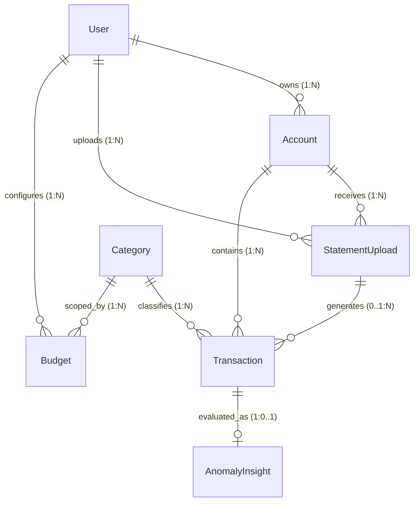

# Database Normalization Documentation (Checkpoint 1)
**Project Name:** Finsight-AI  
**Domain:** AI-Powered Financial Intelligence, Transaction Analytics, and Anomaly Detection  
**Document Version:** 1.0.0  
**Target Submission:** DBMS Project Checkpoint 1 (CP1)  

---

## 1. Introduction

### 1.1 Overview of Database Normalization
Database normalization is a systematic, formal technique in relational database design used to organize tables and attributes in a manner that minimizes data redundancy and eliminates undesirable update, insertion, and deletion anomalies. Originally formulated by Edgar F. Codd in 1970 and extended through higher normal forms, normalization decomposes complex, unnormalized relations into smaller, well-structured relations that adhere to rigorous functional dependency constraints.

Normalization relies on the mathematical principles of relational algebra and functional dependencies. A database schema progresses through several progressive stages:
- **First Normal Form (1NF):** Guarantees atomicity of attributes and eliminates repeating groups or multivalued columns.
- **Second Normal Form (2NF):** Eliminates partial functional dependencies on candidate keys.
- **Third Normal Form (3NF):** Eliminates transitive dependencies between non-prime attributes.
- **Boyce-Codd Normal Form (BCNF):** Enforces that every determinant in a non-trivial functional dependency must be a superkey.

### 1.2 Importance of Normalization for Finsight-AI
**Finsight-AI** is an AI-powered financial intelligence platform engineered to ingest financial statements (CSV, PDF), parse and classify transactions, calculate spending trends and category budgets, and execute automated anomaly detection models (e.g., flagging unusual expenditure spikes, out-of-pattern merchants, and duplicate billings).

In financial platforms, database integrity is non-negotiable:
1. **Ledger Consistency and Accuracy:** Transactions represent real monetary debits and credits. Inconsistent account balances or corrupted transaction associations can lead to erroneous financial calculations and flawed analytics.
2. **ACID Transaction Support:** Financial operations require strict Atomicity, Consistency, Isolation, and Durability. A normalized schema ensures that transactional operations touch minimal, distinct rows, reducing locking contention and transaction deadlocks.
3. **AI Pipeline Reliability:** Machine learning models that detect anomalies rely on clean, unambiguous historical transaction sequences. If metadata such as categories or merchants are duplicated or misspelled across records, model inferences and category aggregates degrade.
4. **Auditability and Compliance:** Maintaining distinct entities for users, financial accounts, statement uploads, categories, and anomaly logs guarantees clear foreign key lineages and audit trails.

### 1.3 Core Objectives of the Normalization Process
The normalization of the Finsight-AI relational database schema accomplishes three primary objectives:
- **Redundancy Minimization:** Prevents duplicate storage of customer profiles, bank account details, document metadata, and category descriptions across millions of transaction records.
- **Anomaly Prevention:**
  - *Insertion Anomalies:* Enables the registration of a new user, creation of a bank account, or configuration of a budget category without requiring fictitious or null transaction entries.
  - *Update Anomalies:* Allows updating a user's password hash or modifying a category description in a single row without leaving legacy or conflicting data across disparate records.
  - *Deletion Anomalies:* Ensures that purging a set of historical transactions does not inadvertently delete the user's master profile, bank account, or active category configuration.
- **Data Integrity and Lossless Decomposition:** Guarantees that all table decompositions are strictly *lossless* (the natural join of decomposed relations exactly reconstructs the original relation) and *dependency-preserving* (every functional dependency can be enforced within individual tables).

### 1.4 Application Domain and Entity Scope
The Finsight-AI data model captures the lifecycle of personal and enterprise finance management:
- **Users:** Individuals registering with authentication credentials (UUID, name, email, password hash, timestamps).
- **Accounts:** Financial accounts (checking, savings, credit card, cash wallet) belonging to a user, with bank names, account numbers, and balances.
- **Statement Uploads:** Raw statement files (CSV, PDF) uploaded by users to ingest transaction batches, tracking file size, type, and processing status.
- **Categories:** Standardized taxonomy for spending and income (e.g., Food & Dining, Utilities, Healthcare, Salary).
- **Transactions:** Individual ledger movements with amounts, transaction dates, descriptions, merchant names, and classification types (income vs. expense).
- **Anomaly Insights:** High-precision AI-generated anomaly flags, scoring, and severity levels tied to specific transactions.
- **Budgets:** Monthly spending ceilings configured by users for specific categories.

---

## 2. Initial Unnormalized Data (UNF)

### 2.1 The Unnormalized Structure
In the absence of relational normalization, financial platforms often ingest data directly from raw bank exports or consolidated flat files (e.g., monolithic spreadsheets or flat CSV reports). In this unnormalized state, a single wide relation attempt to capture user details, financial account details, uploaded statement files, a variable list of transactions, category metadata, and anomaly detection results simultaneously.

We define this monolithic relation as **`UNF_FINANCIAL_LOG`**:

```
UNF_FINANCIAL_LOG (
    user_id,
    user_name,
    user_email,
    password_hash,
    user_created_at,
    account_id,
    account_number,
    account_type,
    bank_name,
    currency,
    account_balance,
    statement_id,
    file_name,
    file_type,
    file_size,
    upload_status,
    upload_date,
    { 
        transaction_id,
        transaction_date,
        amount,
        transaction_type,
        description,
        merchant_name,
        category_id,
        category_name,
        category_type,
        monthly_budget_limit,
        anomaly_id,
        anomaly_type,
        anomaly_score,
        anomaly_severity,
        resolution_status
    }
)
```

The curly brackets `{ ... }` represent a **repeating group** of multiple transactions, nested under a single user, account, and statement upload.

### 2.2 Realistic Sample of Unnormalized Data
The table below illustrates a representative segment of `UNF_FINANCIAL_LOG` showing repeating groups and non-atomic structures:

| user_id | user_name | user_email | account_number | bank_name | file_name | Transactions { txn_id, date, amount, type, merchant, category, budget, anomaly_type, score } |
| :--- | :--- | :--- | :--- | :--- | :--- | :--- |
| `usr-101` | Falak Mishra | `falak@example.com` | `ACC-78901` | Chase Bank | `oct_stmt.csv` | `{ [TX-901, 2026-10-01, 85.50, Expense, Whole Foods, Food & Dining, 500.00, NULL, 0.05], [TX-902, 2026-10-02, 1200.00, Expense, Best Buy, Electronics, 300.00, Unusual Spike, 0.94], [TX-903, 2026-10-05, 4500.00, Income, TechCorp, Salary, NULL, NULL, 0.01] }` |
| `usr-102` | Sarah Jenkins | `sarah@example.com` | `ACC-44512` | Citibank | `sept_export.csv`| `{ [TX-904, 2026-09-15, 14.20, Expense, Starbucks, Food & Dining, 350.00, NULL, 0.02], [TX-905, 2026-09-18, 14.20, Expense, Starbucks, Food & Dining, 350.00, Duplicate Charge, 0.89] }` |
| `usr-103` | David Chen | `david@example.com` | `ACC-99120` | HDFC Bank | NULL | `{ }` *(User created account but has uploaded zero statements and recorded zero transactions)* |

### 2.3 Identified Normalization Issues in UNF
1. **Presence of Repeating Groups:** Each row contains an arbitrary, variable-length array of transaction records. Relational databases cannot index, search, or apply foreign key constraints directly to elements embedded inside nested arrays without significant performance overhead and dialect-specific hacks.
2. **Non-Atomic Values:** Attributes such as transaction details and anomaly telemetry are packaged into aggregate strings or array objects rather than discrete, typed scalar fields.
3. **Absence of a Formal Primary Key:** In UNF, no single attribute or minimal set of scalar attributes uniquely identifies a record because a row contains both scalar master data and nested child arrays.
4. **Excessive Redundancy:** The user's name, email, password hash, account number, bank name, and file upload details are physically repeated across multiple transaction rows if flattened carelessly.

### 2.4 Severe Database Anomalies in UNF
The unnormalized structure suffers from three classical database anomalies:
- **Insertion Anomaly:**
  - A new user (e.g., `usr-103`) who registers on Finsight-AI cannot have their details stored without either placing empty `NULL` values in all transaction and statement attributes or forcing artificial dummy transactions.
  - A new spending category (e.g., "Healthcare") cannot be defined in the system until at least one transaction in that category is recorded.
- **Update Anomaly:**
  - If user `usr-101` changes their email address from `falak@example.com` to `falak.m@example.com`, every transaction record referencing this user must be updated. If the database updates some rows but fails on others (e.g., due to a system crash or concurrent write), the database falls into an inconsistent state with conflicting email addresses for the same user.
  - If the budget for "Food & Dining" is updated from 500.00 to 600.00, this value must be manually propagated across hundreds of historical transaction rows.
- **Deletion Anomaly:**
  - If user `usr-102` deletes their two transactions (`TX-904` and `TX-905`) because they were recorded in error, the entire row is deleted. Consequently, the user's account details (`ACC-44512`), Citibank affiliation, and statement upload record (`sept_export.csv`) are permanently erased from the database.

---

## 3. First Normal Form (1NF)

### 3.1 Conversion Strategy: UNF to 1NF
To transition the unnormalized schema into **First Normal Form (1NF)**, the following foundational relational conditions must be met:
1. **Attribute Atomicity:** Every attribute must contain only atomic (indivisible) scalar values from its defined domain. No sets, lists, arrays, JSON blobs, or composite structures are permitted.
2. **Elimination of Repeating Groups:** Every nested collection of transactions must be expanded into distinct, individual tuples.
3. **Unique Record Identification:** Every row must be uniquely identifiable through a formally defined primary key.
4. **Order Independence:** The order of rows and columns must have no semantic significance.

To achieve 1NF, we eliminate the repeating group `{ ... }` from `UNF_FINANCIAL_LOG`. We flatten the structure such that each row represents exactly **one transaction occurrence**, replicating the parent user, account, and statement attributes across each flattened row.

### 3.2 1NF Relation Schema: `FLAT_FINANCIAL_RECORD`
The resulting first normal form relation is denoted as:

```
FLAT_FINANCIAL_RECORD (
    account_id,
    transaction_id,
    user_id,
    user_name,
    user_email,
    password_hash,
    user_created_at,
    account_number,
    account_type,
    bank_name,
    currency,
    account_balance,
    statement_id,
    file_name,
    file_type,
    file_size,
    upload_status,
    upload_date,
    transaction_date,
    amount,
    transaction_type,
    description,
    merchant_name,
    category_id,
    category_name,
    category_type,
    monthly_budget_limit,
    anomaly_id,
    anomaly_type,
    anomaly_score,
    anomaly_severity,
    resolution_status
)
```

### 3.3 Identification of Primary Key and Candidate Keys
In this flattened relation:
- A user has multiple accounts.
- An account has multiple uploaded statements and multiple transactions.
- A single transaction belongs to an account and occurs on a given date.
- The attribute combination **`{account_id, transaction_id}`** uniquely identifies every tuple in the relation. If transactions are globally unique via UUID (`transaction_id`), then `{transaction_id}` alone is sufficient to identify each row; however, in a composite multi-entity domain where transactions originate within the context of an account ledger, the natural candidate key for the flattened relation is the composite key:

$$\text{Candidate Key (CK)} = \{\text{account\_id}, \text{transaction\_id}\}$$

We designate **`{account_id, transaction_id}`** as the Primary Key for `FLAT_FINANCIAL_RECORD`.

### 3.4 Illustrative 1NF Sample Table
Below is a sample of the flattened 1NF relation:

| account_id (PK) | transaction_id (PK) | user_id | user_email | bank_name | amount | merchant_name | category_name | anomaly_type | anomaly_score |
| :--- | :--- | :--- | :--- | :--- | :--- | :--- | :--- | :--- | :--- |
| `ACC-78901` | `TX-901` | `usr-101` | `falak@example.com` | Chase Bank | 85.50 | Whole Foods | Food & Dining | NONE | 0.05 |
| `ACC-78901` | `TX-902` | `usr-101` | `falak@example.com` | Chase Bank | 1200.00 | Best Buy | Electronics | Unusual Spike | 0.94 |
| `ACC-78901` | `TX-903` | `usr-101` | `falak@example.com` | Chase Bank | 4500.00 | TechCorp | Salary | NONE | 0.01 |
| `ACC-44512` | `TX-904` | `usr-102` | `sarah@example.com` | Citibank | 14.20 | Starbucks | Food & Dining | NONE | 0.02 |
| `ACC-44512` | `TX-905` | `usr-102` | `sarah@example.com` | Citibank | 14.20 | Starbucks | Food & Dining | Duplicate Charge | 0.89 |

### 3.5 Evaluation of What Changed from UNF to 1NF
- All repeating groups of transactions and anomaly telemetry were unpacked into distinct scalar rows.
- Every cell now contains a single atomic value (e.g., individual decimals, strings, dates).
- A definitive composite primary key `{account_id, transaction_id}` was established.
- **Remaining Shortcoming:** While 1NF resolves repeating groups, it introduces massive data duplication. The user details (`user_name`, `user_email`, `bank_name`) are duplicated for every single transaction under that account. This directly triggers **partial functional dependencies**, violating 2NF.

---

## 4. Second Normal Form (2NF)

### 4.1 Theoretical Foundation of 2NF
A relation $R$ is in **Second Normal Form (2NF)** if and only if:
1. It is already in **First Normal Form (1NF)**.
2. Every **non-prime attribute** (an attribute not belonging to any candidate key) is **fully functionally dependent** on the entirety of every candidate key of $R$.

In formal terms, a relation violates 2NF if there exists a **partial functional dependency**:

$$X \subset CK \quad \text{and} \quad X \to Y \quad (Y \notin CK)$$

where $X$ is a strict proper subset of a candidate key $CK$, and $Y$ is a non-prime attribute.

> [!NOTE]
> If a relation in 1NF possesses only **single-attribute candidate keys**, it automatically satisfies 2NF because no proper subset of a single-attribute key exists. 2NF violations occur strictly when candidate keys are **composite**.

### 4.2 Analysis of Partial Dependencies in `FLAT_FINANCIAL_RECORD`
In the 1NF relation `FLAT_FINANCIAL_RECORD`, the primary key is the composite key:

$$PK = \{\text{account\_id}, \text{transaction\_id}\}$$

The prime attributes are:
$$\text{Prime Attributes} = \{\text{account\_id}, \text{transaction\_id}\}$$

All other attributes are non-prime attributes. We analyze their functional dependencies:

#### Partial Dependency Group 1 (Dependent on `account_id` alone):
The financial account and owner details depend solely on `account_id`, completely independent of which transaction occurred:

$$\text{account\_id} \to \{\text{user\_id}, \text{user\_name}, \text{user\_email}, \text{password\_hash}, \text{user\_created\_at}, \text{account\_number}, \text{account\_type}, \text{bank\_name}, \text{currency}, \text{account\_balance}\}$$

Here, $\text{account\_id} \subset \{\text{account\_id}, \text{transaction\_id}\}$. Because non-prime attributes depend on a proper subset of the primary key, this is a **flagrant violation of 2NF**.

#### Partial Dependency Group 2 (Dependent on `transaction_id` alone):
The transaction amounts, timestamps, merchant data, category descriptors, statement linkages, and anomaly evaluations depend solely on the specific transaction:

$$\begin{aligned}
\text{transaction\_id} \to \{ & \text{transaction\_date}, \text{amount}, \text{transaction\_type}, \text{description}, \text{merchant\_name}, \\
& \text{category\_id}, \text{category\_name}, \text{category\_type}, \text{monthly\_budget\_limit}, \\
& \text{statement\_id}, \text{file\_name}, \text{file\_type}, \text{file\_size}, \text{upload\_status}, \text{upload\_date}, \\
& \text{anomaly\_id}, \text{anomaly\_type}, \text{anomaly\_score}, \text{anomaly\_severity}, \text{resolution\_status} \}
\end{aligned}$$

Here, $\text{transaction\_id} \subset \{\text{account\_id}, \text{transaction\_id}\}$. This is also a **partial functional dependency**.

### 4.3 2NF Decomposition
To eliminate all partial functional dependencies, we decompose `FLAT_FINANCIAL_RECORD` into two distinct relations according to their determining keys:

#### Relation 1: `ACCOUNT_USER_RECORD`
This relation encapsulates all attributes dependent strictly on `account_id`:
- **Attributes:** `account_id`, `user_id`, `user_name`, `user_email`, `password_hash`, `user_created_at`, `account_number`, `account_type`, `bank_name`, `currency`, `account_balance`
- **Primary Key (PK):** `account_id`
- **Candidate Keys:** `{account_id}`, `{(bank_name, account_number)}`
- **Justification:** Because the primary key is a single attribute (`account_id`), no proper subset exists. Thus, `ACCOUNT_USER_RECORD` satisfies 2NF.

#### Relation 2: `TRANSACTION_RECORD`
This relation encapsulates transaction details, maintaining a foreign key reference to the account:
- **Attributes:** `transaction_id`, `account_id` (FK), `transaction_date`, `amount`, `transaction_type`, `description`, `merchant_name`, `category_id`, `category_name`, `category_type`, `monthly_budget_limit`, `statement_id`, `file_name`, `file_type`, `file_size`, `upload_status`, `upload_date`, `anomaly_id`, `anomaly_type`, `anomaly_score`, `anomaly_severity`, `resolution_status`
- **Primary Key (PK):** `transaction_id`
- **Foreign Key (FK):** `account_id` references `ACCOUNT_USER_RECORD(account_id)`
- **Justification:** The primary key is the single attribute `transaction_id`. There are no composite candidate keys; therefore, no partial dependencies can exist. `TRANSACTION_RECORD` satisfies 2NF.

### 4.4 Verification of 2NF Properties
1. **Lossless Decomposition:** The natural join $\text{ACCOUNT\_USER\_RECORD} \bowtie_{\text{account\_id}} \text{TRANSACTION\_RECORD}$ accurately reconstructs `FLAT_FINANCIAL_RECORD` without spurious tuples because the join attribute `account_id` is the primary key of `ACCOUNT_USER_RECORD`.
2. **Dependency Preservation:** All functional dependencies from the original relation are preserved across the decomposed relations.

---

## 5. Third Normal Form (3NF)

### 5.1 Theoretical Foundation of 3NF
A relation $R$ is in **Third Normal Form (3NF)** if and only if:
1. It is already in **Second Normal Form (2NF)**.
2. For every non-trivial functional dependency $X \to Y$ in $R$, at least one of the following conditions holds:
   - $X$ is a **superkey** of $R$, OR
   - $Y$ is a **prime attribute** (i.e., $Y$ is part of a candidate key of $R$).

In intuitive terms, 3NF requires that **no non-prime attribute is transitively dependent on any candidate key**. A transitive dependency occurs when:

$$PK \to X \quad \text{and} \quad X \to Y$$

where $X$ is not a candidate key (or superkey) and $Y$ is a non-prime attribute not part of the primary key.

### 5.2 Analysis of Transitive Dependencies in 2NF Relations

While the 2NF relations eliminated partial key dependencies, both `ACCOUNT_USER_RECORD` and `TRANSACTION_RECORD` suffer from severe **transitive dependencies**:

#### A. Transitive Dependencies in `ACCOUNT_USER_RECORD`
In `ACCOUNT_USER_RECORD(account_id, user_id, user_name, user_email, password_hash, user_created_at, account_number, account_type, bank_name, currency, account_balance)`:
- We have the primary key dependency:
  $$\text{account\_id} \to \text{user\_id}$$
- However, the user attributes are determined directly by `user_id`:
  $$\text{user\_id} \to \{\text{user\_name}, \text{user\_email}, \text{password\_hash}, \text{user\_created\_at}\}$$
- Since `user_id` is **not a superkey** of `ACCOUNT_USER_RECORD` (a single user can hold multiple accounts at different banks), and `user_name`, `user_email`, `password_hash` are **non-prime attributes**, this represents a transitive dependency:
  $$\text{account\_id} \to \text{user\_id} \to \{\text{user\_name}, \text{user\_email}, \text{password\_hash}, \text{user\_created\_at}\}$$
- **3NF Violation:** If a user opens 3 bank accounts, their name, email, and password hash are duplicated 3 times.

#### B. Transitive Dependencies in `TRANSACTION_RECORD`
In `TRANSACTION_RECORD`, multiple non-key determinants exist:

1. **Category Transitive Dependency:**
   - $\text{transaction\_id} \to \text{category\_id}$
   - $\text{category\_id} \to \{\text{category\_name}, \text{category\_type}\}$
   - Since `category_id` is not a superkey of `TRANSACTION_RECORD` (many transactions share the same category), and `category_name`, `category_type` are non-prime attributes, we have:
     $$\text{transaction\_id} \to \text{category\_id} \to \{\text{category\_name}, \text{category\_type}\}$$
   - **3NF Violation:** Every time a transaction occurs in "Food & Dining", the string "Food & Dining" and its type "Expense" are duplicated.

2. **Statement Upload Transitive Dependency:**
   - $\text{transaction\_id} \to \text{statement\_id}$
   - $\text{statement\_id} \to \{\text{file\_name}, \text{file\_type}, \text{file\_size}, \text{upload\_status}, \text{upload\_date}\}$
   - `statement_id` is not a superkey of `TRANSACTION_RECORD` (one statement file contains dozens or hundreds of transactions).
   - This forms the transitive dependency:
     $$\text{transaction\_id} \to \text{statement\_id} \to \{\text{file\_name}, \text{file\_type}, \text{file\_size}, \text{upload\_status}, \text{upload\_date}\}$$
   - **3NF Violation:** File metadata is repeated for every parsed transaction line.

3. **Anomaly Insight Transitive / Optional Dependency:**
   - $\text{transaction\_id} \to \text{anomaly\_id}$
   - $\text{anomaly\_id} \to \{\text{anomaly\_type}, \text{anomaly\_score}, \text{anomaly\_severity}, \text{resolution\_status}\}$
   - Transactions that are completely benign have `NULL` across all anomaly attributes. Furthermore, anomaly analysis is an independent AI evaluation process where `anomaly_id` is the primary determinant of detection metadata:
     $$\text{transaction\_id} \to \text{anomaly\_id} \to \{\text{anomaly\_type}, \text{anomaly\_score}, \text{anomaly\_severity}, \text{resolution\_status}\}$$
   - **3NF Violation:** Transitive determination of anomaly metrics through `anomaly_id`.

4. **Category Budget Dependency:**
   - $\text{user\_id}, \text{category\_id} \to \text{monthly\_budget\_limit}$
   - Storing `monthly_budget_limit` directly inside transaction rows duplicates budget configuration millions of times. The budget ceiling is a property of the user's planning configuration for a category, not an intrinsic property of a single ledger charge.

### 5.3 3NF Decomposition
To eradicate all transitive dependencies, we decompose the relations into dedicated entities, each modeled around its own functional determinant:

#### 1. Relation `User`
Isolates user account credentials and profile metadata.
- **Attributes:** `user_id`, `name`, `email`, `password_hash`, `created_at`, `updated_at`
- **Primary Key (PK):** `user_id`
- **Candidate Keys:** `{user_id}`, `{email}`
- **Foreign Keys:** None

#### 2. Relation `Account`
Captures financial depository and credit accounts linked to a user.
- **Attributes:** `account_id`, `user_id` (FK), `account_number`, `account_name`, `account_type`, `bank_name`, `currency`, `balance`, `created_at`, `updated_at`
- **Primary Key (PK):** `account_id`
- **Candidate Keys:** `{account_id}`, `{(bank_name, account_number)}`
- **Foreign Keys:** `user_id` references `User(user_id)`

#### 3. Relation `Category`
Captures standard and custom classification taxonomies.
- **Attributes:** `category_id`, `category_name`, `category_type`, `description`, `created_at`
- **Primary Key (PK):** `category_id`
- **Candidate Keys:** `{category_id}`, `{category_name}`
- **Foreign Keys:** None

#### 4. Relation `StatementUpload`
Tracks raw document uploads, file metadata, and batch ingestion status.
- **Attributes:** `statement_id`, `account_id` (FK), `user_id` (FK), `file_name`, `file_type`, `file_size`, `upload_status`, `uploaded_at`
- **Primary Key (PK):** `statement_id`
- **Candidate Keys:** `{statement_id}`
- **Foreign Keys:**
  - `account_id` references `Account(account_id)`
  - `user_id` references `User(user_id)`

#### 5. Relation `Transaction`
Stores core transactional records, referencing account, category, and source statement.
- **Attributes:** `transaction_id`, `account_id` (FK), `category_id` (FK), `statement_id` (FK, nullable), `amount`, `transaction_type`, `transaction_date`, `description`, `merchant_name`, `created_at`
- **Primary Key (PK):** `transaction_id`
- **Candidate Keys:** `{transaction_id}`
- **Foreign Keys:**
  - `account_id` references `Account(account_id)`
  - `category_id` references `Category(category_id)`
  - `statement_id` references `StatementUpload(statement_id)`

#### 6. Relation `AnomalyInsight`
Encapsulates AI telemetry, detection confidence, and remediation status.
- **Attributes:** `anomaly_id`, `transaction_id` (FK), `anomaly_type`, `anomaly_score`, `severity`, `resolution_status`, `detected_at`
- **Primary Key (PK):** `anomaly_id`
- **Candidate Keys:** `{anomaly_id}`, `{transaction_id}` (assuming at most one primary anomaly verdict per transaction)
- **Foreign Keys:** `transaction_id` references `Transaction(transaction_id)`

#### 7. Relation `Budget`
Tracks monthly category expenditure limits set by users.
- **Attributes:** `budget_id`, `user_id` (FK), `category_id` (FK), `monthly_limit`, `period_month`, `period_year`, `created_at`
- **Primary Key (PK):** `budget_id`
- **Candidate Keys:** `{budget_id}`, `{(user_id, category_id, period_month, period_year)}`
- **Foreign Keys:**
  - `user_id` references `User(user_id)`
  - `category_id` references `Category(category_id)`

### 5.4 Resolution of 3NF Violations
- **No Transitive Dependencies:** In every decomposed relation, all non-prime attributes depend solely and directly on candidate keys.
- **Clean Null Handling:** Non-anomalous transactions have no associated row in `AnomalyInsight`, completely eliminating `NULL` padding across the dataset.
- **Lossless and Dependency-Preserving:** All relations join losslessly via primary key / foreign key equijoins, and all business dependencies ($X \to Y$) are fully preserved.

---

## 6. Boyce-Codd Normal Form (BCNF)

### 6.1 Theoretical Foundation of BCNF
**Boyce-Codd Normal Form (BCNF)**, often considered a stricter version of 3NF, addresses anomalies that can arise when a relation has multiple overlapping candidate keys.

Formally, a relation $R$ is in **BCNF** if and only if:
> For every non-trivial functional dependency $X \to Y$ defined on $R$, the determinant $X$ is a **superkey** of $R$.

### 6.2 Comparison Between 3NF and BCNF
In 3NF, the condition for a functional dependency $X \to Y$ is:
- $X$ is a superkey, **OR**
- $Y$ is a prime attribute.

BCNF removes the second clause ($Y \in \text{Prime}$). In BCNF, *no attribute—prime or non-prime—is permitted to depend on a determinant that is not a superkey*. 

A violation of BCNF occurs when a relation has:
1. Multiple candidate keys.
2. The candidate keys are composite.
3. The candidate keys overlap (share at least one attribute).
4. An attribute of one candidate key is functionally determined by a non-superkey.

### 6.3 Rigorous BCNF Evaluation of All 3NF Relations
We systematically test every decomposed relation resulting from Section 5 to determine whether any non-superkey determinant exists.

#### 1. Evaluation of `User`
- **Candidate Keys:** $CK_1 = \{\text{user\_id}\}$, $CK_2 = \{\text{email}\}$
- **Functional Dependencies:**
  - $\text{user\_id} \to \{\text{name}, \text{email}, \text{password\_hash}, \text{created\_at}, \text{updated\_at}\}$
  - $\text{email} \to \{\text{user\_id}, \text{name}, \text{password\_hash}, \text{created\_at}, \text{updated\_at}\}$
- **Evaluation:** Both determinants $\text{user\_id}$ and $\text{email}$ are candidate keys, and therefore superkeys.
- **Verdict:** **Satisfies BCNF.**

#### 2. Evaluation of `Account`
- **Candidate Keys:** $CK_1 = \{\text{account\_id}\}$, $CK_2 = \{(\text{bank\_name}, \text{account\_number})\}$
- **Functional Dependencies:**
  - $\text{account\_id} \to \{\text{user\_id}, \text{account\_number}, \text{account\_name}, \text{account\_type}, \text{bank\_name}, \text{currency}, \text{balance}, \text{created\_at}, \text{updated\_at}\}$
  - $\{(\text{bank\_name}, \text{account\_number})\} \to \{\text{account\_id}, \text{user\_id}, \text{account\_name}, \text{account\_type}, \text{currency}, \text{balance}, \text{created\_at}, \text{updated\_at}\}$
- **Evaluation:**
  - Determinant $\text{account\_id}$ is a candidate key $\implies$ superkey.
  - Determinant $\{(\text{bank\_name}, \text{account\_number})\}$ is a composite candidate key $\implies$ superkey.
  - No subset of candidate keys determines any other attribute.
- **Verdict:** **Satisfies BCNF.**

#### 3. Evaluation of `Category`
- **Candidate Keys:** $CK_1 = \{\text{category\_id}\}$, $CK_2 = \{\text{category\_name}\}$
- **Functional Dependencies:**
  - $\text{category\_id} \to \{\text{category\_name}, \text{category\_type}, \text{description}, \text{created\_at}\}$
  - $\text{category\_name} \to \{\text{category\_id}, \text{category\_type}, \text{description}, \text{created\_at}\}$
- **Evaluation:** Both determinants are candidate keys (superkeys).
- **Verdict:** **Satisfies BCNF.**

#### 4. Evaluation of `StatementUpload`
- **Candidate Keys:** $CK_1 = \{\text{statement\_id}\}$
- **Functional Dependencies:**
  - $\text{statement\_id} \to \{\text{account\_id}, \text{user\_id}, \text{file\_name}, \text{file\_type}, \text{file\_size}, \text{upload\_status}, \text{uploaded\_at}\}$
- **Evaluation:** The sole determinant is $\text{statement\_id}$, which is the primary candidate key (superkey).
- **Verdict:** **Satisfies BCNF.**

#### 5. Evaluation of `Transaction`
- **Candidate Keys:** $CK_1 = \{\text{transaction\_id}\}$
- **Functional Dependencies:**
  - $\text{transaction\_id} \to \{\text{account\_id}, \text{category\_id}, \text{statement\_id}, \text{amount}, \text{transaction\_type}, \text{transaction\_date}, \text{description}, \text{merchant\_name}, \text{created\_at}\}$
- **Evaluation:** The sole determinant is $\text{transaction\_id}$, which is the primary candidate key (superkey). No subset of foreign keys forms a dependency on another non-superkey attribute.
- **Verdict:** **Satisfies BCNF.**

#### 6. Evaluation of `AnomalyInsight`
- **Candidate Keys:** $CK_1 = \{\text{anomaly\_id}\}$, $CK_2 = \{\text{transaction\_id}\}$
- **Functional Dependencies:**
  - $\text{anomaly\_id} \to \{\text{transaction\_id}, \text{anomaly\_type}, \text{anomaly\_score}, \text{severity}, \text{resolution\_status}, \text{detected\_at}\}$
  - $\text{transaction\_id} \to \{\text{anomaly\_id}, \text{anomaly\_type}, \text{anomaly\_score}, \text{severity}, \text{resolution\_status}, \text{detected\_at}\}$
- **Evaluation:** Both determinants are candidate keys (superkeys).
- **Verdict:** **Satisfies BCNF.**

#### 7. Evaluation of `Budget`
- **Candidate Keys:** $CK_1 = \{\text{budget\_id}\}$, $CK_2 = \{(\text{user\_id}, \text{category\_id}, \text{period\_month}, \text{period\_year})\}$
- **Functional Dependencies:**
  - $\text{budget\_id} \to \{\text{user\_id}, \text{category\_id}, \text{monthly\_limit}, \text{period\_month}, \text{period\_year}, \text{created\_at}\}$
  - $\{(\text{user\_id}, \text{category\_id}, \text{period\_month}, \text{period\_year})\} \to \{\text{budget\_id}, \text{monthly\_limit}, \text{created\_at}\}$
- **Evaluation:** Both determinants are candidate keys (superkeys).
- **Verdict:** **Satisfies BCNF.**

### 6.4 BCNF Conclusion
Because **every determinant in every non-trivial functional dependency across all seven relations is a superkey**, the database schema **strictly satisfies Boyce-Codd Normal Form (BCNF)** without requiring any further decomposition. No overlapping candidate key anomalies exist in this schema.

---

## 7. Final Normalized Database Schema

The normalized relational schema for **Finsight-AI** comprises seven clean, BCNF-compliant relations.

### 7.1 Relational Tables Specification

#### 1. Table: `User`
Stores user profile information, authentication credentials, and account registration timestamps. Directly aligns with the project's Prisma model.

| Column Name | Data Type | Key | Constraints | Description |
| :--- | :--- | :--- | :--- | :--- |
| `id` | `UUID` | **PK** | `NOT NULL`, `DEFAULT gen_random_uuid()` | Unique identifier for the user |
| `name` | `VARCHAR(100)` | | `NOT NULL` | Full display name of the user |
| `email` | `VARCHAR(255)` | | `NOT NULL`, `UNIQUE` | User email address used for authentication |
| `password` | `VARCHAR(255)` | | `NOT NULL` | Secure salted and hashed password |
| `createdAt` | `TIMESTAMP(3)` | | `NOT NULL`, `DEFAULT CURRENT_TIMESTAMP` | Account creation timestamp |
| `updatedAt` | `TIMESTAMP(3)` | | `NOT NULL` | Last account modification timestamp |

---

#### 2. Table: `Account`
Stores financial depository accounts, bank institutions, card providers, and current running balances.

| Column Name | Data Type | Key | Constraints | Description |
| :--- | :--- | :--- | :--- | :--- |
| `account_id` | `UUID` | **PK** | `NOT NULL`, `DEFAULT gen_random_uuid()` | Unique account identifier |
| `user_id` | `UUID` | **FK** | `NOT NULL`, References `User(id)` | Owner of the financial account |
| `account_number` | `VARCHAR(50)` | | `NOT NULL` | Masked or institutional account identifier |
| `account_name` | `VARCHAR(100)` | | `NOT NULL` | Friendly name (e.g., "Primary Checking") |
| `account_type` | `VARCHAR(30)` | | `NOT NULL`, `CHECK (account_type IN ('CHECKING', 'SAVINGS', 'CREDIT_CARD', 'INVESTMENT', 'CASH'))` | Financial account classification |
| `bank_name` | `VARCHAR(100)` | | `NOT NULL` | Financial institution name |
| `currency` | `CHAR(3)` | | `NOT NULL`, `DEFAULT 'USD'` | ISO 4217 three-letter currency code |
| `balance` | `DECIMAL(14,2)`| | `NOT NULL`, `DEFAULT 0.00` | Reconciled running balance |
| `created_at` | `TIMESTAMP(3)` | | `NOT NULL`, `DEFAULT CURRENT_TIMESTAMP` | Account record creation timestamp |
| `updated_at` | `TIMESTAMP(3)` | | `NOT NULL` | Last modification timestamp |

*Additional Table Constraints:*
- `UNIQUE (bank_name, account_number)`: An account number must be unique within a banking institution.

---

#### 3. Table: `Category`
Defines standardized transaction spending and income taxonomies.

| Column Name | Data Type | Key | Constraints | Description |
| :--- | :--- | :--- | :--- | :--- |
| `category_id` | `UUID` | **PK** | `NOT NULL`, `DEFAULT gen_random_uuid()` | Unique category identifier |
| `category_name` | `VARCHAR(60)` | | `NOT NULL`, `UNIQUE` | Category title (e.g., "Food & Dining") |
| `category_type` | `VARCHAR(20)` | | `NOT NULL`, `CHECK (category_type IN ('INCOME', 'EXPENSE', 'TRANSFER'))` | Income vs. expense classification |
| `description` | `VARCHAR(255)` | | | Explanatory description of category scope |
| `created_at` | `TIMESTAMP(3)` | | `NOT NULL`, `DEFAULT CURRENT_TIMESTAMP` | Creation timestamp |

---

#### 4. Table: `StatementUpload`
Tracks batch file imports (CSV/PDF) uploaded by users for transaction extraction. Matches `upload.service.js` specifications.

| Column Name | Data Type | Key | Constraints | Description |
| :--- | :--- | :--- | :--- | :--- |
| `statement_id` | `UUID` | **PK** | `NOT NULL`, `DEFAULT gen_random_uuid()` | Unique statement upload identifier |
| `account_id` | `UUID` | **FK** | `NOT NULL`, References `Account(account_id)` | Target account for statement ingestion |
| `user_id` | `UUID` | **FK** | `NOT NULL`, References `User(id)` | User who uploaded the statement |
| `file_name` | `VARCHAR(255)` | | `NOT NULL` | Original uploaded document name |
| `file_type` | `VARCHAR(50)` | | `NOT NULL` | MIME type or extension (e.g., 'csv', 'pdf') |
| `file_size` | `INTEGER` | | `NOT NULL`, `CHECK (file_size > 0)` | Byte size of uploaded file |
| `upload_status` | `VARCHAR(30)` | | `NOT NULL`, `CHECK (upload_status IN ('PENDING', 'PROCESSING', 'PROCESSED', 'FAILED'))` | Ingestion workflow status |
| `uploaded_at` | `TIMESTAMP(3)` | | `NOT NULL`, `DEFAULT CURRENT_TIMESTAMP` | Ingestion timestamp |

---

#### 5. Table: `Transaction`
Stores individual ledger movements. Implements requirements from `transaction.service.js` and `transaction.repository.js`.

| Column Name | Data Type | Key | Constraints | Description |
| :--- | :--- | :--- | :--- | :--- |
| `transaction_id` | `UUID` | **PK** | `NOT NULL`, `DEFAULT gen_random_uuid()` | Unique transaction identifier |
| `account_id` | `UUID` | **FK** | `NOT NULL`, References `Account(account_id)` | Source financial account |
| `category_id` | `UUID` | **FK** | `NOT NULL`, References `Category(category_id)`| Assigned spending/income category |
| `statement_id` | `UUID` | **FK** | References `StatementUpload(statement_id)` | Source statement batch (NULL if manually created) |
| `amount` | `DECIMAL(12,2)`| | `NOT NULL`, `CHECK (amount > 0)` | Positive monetary magnitude |
| `transaction_type`| `VARCHAR(20)`| | `NOT NULL`, `CHECK (transaction_type IN ('INCOME', 'EXPENSE', 'TRANSFER'))` | Direction of funds |
| `transaction_date`| `TIMESTAMP(3)`| | `NOT NULL` | Date and time the transaction took place |
| `description` | `VARCHAR(255)` | | `NOT NULL`, `DEFAULT 'No description'` | Memo or narrative from transaction slip |
| `merchant_name` | `VARCHAR(100)` | | `NOT NULL` | Normalized merchant or counterparty name |
| `created_at` | `TIMESTAMP(3)` | | `NOT NULL`, `DEFAULT CURRENT_TIMESTAMP` | Record creation timestamp |

---

#### 6. Table: `AnomalyInsight`
Houses machine learning telemetry, outlier scores, and resolution workflows for transactions flagged by Finsight-AI's intelligence models.

| Column Name | Data Type | Key | Constraints | Description |
| :--- | :--- | :--- | :--- | :--- |
| `anomaly_id` | `UUID` | **PK** | `NOT NULL`, `DEFAULT gen_random_uuid()` | Unique anomaly verdict identifier |
| `transaction_id` | `UUID` | **FK** | `NOT NULL`, `UNIQUE`, References `Transaction(transaction_id)` | Associated anomalous transaction |
| `anomaly_type` | `VARCHAR(50)` | | `NOT NULL`, `CHECK (anomaly_type IN ('UNUSUAL_SPIKE', 'DUPLICATE_CHARGE', 'UNKNOWN_MERCHANT', 'VELOCITY_ALERT', 'WEEKEND_ANOMALY'))` | Algorithmic anomaly category |
| `anomaly_score` | `DECIMAL(4,3)` | | `NOT NULL`, `CHECK (anomaly_score BETWEEN 0.000 AND 1.000)` | Model confidence score (0.0 to 1.0) |
| `severity` | `VARCHAR(20)` | | `NOT NULL`, `CHECK (severity IN ('LOW', 'MEDIUM', 'HIGH', 'CRITICAL'))` | Risk level |
| `resolution_status`| `VARCHAR(30)`| | `NOT NULL`, `DEFAULT 'FLAGGED'`, `CHECK (resolution_status IN ('FLAGGED', 'CONFIRMED_FRAUD', 'FALSE_POSITIVE', 'RESOLVED'))` | User/system workflow state |
| `detected_at` | `TIMESTAMP(3)` | | `NOT NULL`, `DEFAULT CURRENT_TIMESTAMP` | Detection execution timestamp |

---

#### 7. Table: `Budget`
Tracks user spending goals and thresholds per category for budget tracking and analytics reporting (aligning with `report.repository.js`).

| Column Name | Data Type | Key | Constraints | Description |
| :--- | :--- | :--- | :--- | :--- |
| `budget_id` | `UUID` | **PK** | `NOT NULL`, `DEFAULT gen_random_uuid()` | Unique budget entry identifier |
| `user_id` | `UUID` | **FK** | `NOT NULL`, References `User(id)` | Target user configuring the limit |
| `category_id` | `UUID` | **FK** | `NOT NULL`, References `Category(category_id)`| Category under budget enforcement |
| `monthly_limit` | `DECIMAL(12,2)`| | `NOT NULL`, `CHECK (monthly_limit >= 0)` | Maximum allocated spending ceiling |
| `period_month` | `SMALLINT` | | `NOT NULL`, `CHECK (period_month BETWEEN 1 AND 12)`| Target calendar month (1 - 12) |
| `period_year` | `SMALLINT` | | `NOT NULL`, `CHECK (period_year >= 2020)` | Target calendar year |
| `created_at` | `TIMESTAMP(3)` | | `NOT NULL`, `DEFAULT CURRENT_TIMESTAMP` | Record creation timestamp |

*Additional Table Constraints:*
- `UNIQUE (user_id, category_id, period_month, period_year)`: Prevents multiple distinct budget ceilings for the same user, category, and month.

---

### 7.2 Entity Relationship and Cardinality Overview



#### Cardinality Specifications:
1. **`User` to `Account` (1 : N):** One user can own multiple bank accounts or credit cards; each account belongs to exactly one user.
2. **`Account` to `Transaction` (1 : N):** One account holds many transaction records; each transaction belongs to exactly one account.
3. **`Category` to `Transaction` (1 : N):** One category classifies many transactions; each transaction is assigned to exactly one category.
4. **`StatementUpload` to `Transaction` (1 : N):** One uploaded statement file extracts zero, one, or many transactions; each transaction optionally originates from one statement file (or is entered manually, represented by a `NULL` foreign key).
5. **`Transaction` to `AnomalyInsight` (1 : 0..1):** A transaction produces at most one active anomaly verdict. Regular transactions have zero associated anomaly rows.
6. **`User` to `Budget` (1 : N):** One user configures multiple monthly category budgets.
7. **`Category` to `Budget` (1 : N):** One category can be budgeted across multiple months and users.

---

## 8. Functional Dependencies Summary

The formal functional dependencies governing the Finsight-AI relational database schema are consolidated below, classified by their host relation:

### 8.1 Functional Dependencies by Relation

#### 1. Relation: `User`
- **Candidate Keys:** $\{id\}$, $\{email\}$
- **Functional Dependencies:**
  - $id \to \{name, email, password, createdAt, updatedAt\}$
  - $email \to \{id, name, password, createdAt, updatedAt\}$
- **Determinant Analysis:** Both $id$ and $email$ are candidate keys (and superkeys).

#### 2. Relation: `Account`
- **Candidate Keys:** $\{account\_id\}$, $\{(bank\_name, account\_number)\}$
- **Functional Dependencies:**
  - $account\_id \to \{user\_id, account\_number, account\_name, account\_type, bank\_name, currency, balance, created\_at, updated\_at\}$
  - $(bank\_name, account\_number) \to \{account\_id, user\_id, account\_name, account\_type, currency, balance, created\_at, updated\_at\}$
- **Determinant Analysis:** Both determinants are candidate keys (and superkeys).

#### 3. Relation: `Category`
- **Candidate Keys:** $\{category\_id\}$, $\{category\_name\}$
- **Functional Dependencies:**
  - $category\_id \to \{category\_name, category\_type, description, created\_at\}$
  - $category\_name \to \{category\_id, category\_type, description, created\_at\}$
- **Determinant Analysis:** Both $category\_id$ and $category\_name$ are candidate keys (and superkeys).

#### 4. Relation: `StatementUpload`
- **Candidate Keys:** $\{statement\_id\}$
- **Functional Dependencies:**
  - $statement\_id \to \{account\_id, user\_id, file\_name, file\_type, file\_size, upload\_status, uploaded\_at\}$
- **Determinant Analysis:** The determinant $statement\_id$ is the primary key (and superkey).

#### 5. Relation: `Transaction`
- **Candidate Keys:** $\{transaction\_id\}$
- **Functional Dependencies:**
  - $transaction\_id \to \{account\_id, category\_id, statement\_id, amount, transaction\_type, transaction\_date, description, merchant\_name, created\_at\}$
- **Determinant Analysis:** The determinant $transaction\_id$ is the primary key (and superkey).

#### 6. Relation: `AnomalyInsight`
- **Candidate Keys:** $\{anomaly\_id\}$, $\{transaction\_id\}$
- **Functional Dependencies:**
  - $anomaly\_id \to \{transaction\_id, anomaly\_type, anomaly\_score, severity, resolution\_status, detected\_at\}$
  - $transaction\_id \to \{anomaly\_id, anomaly\_type, anomaly\_score, severity, resolution\_status, detected\_at\}$
- **Determinant Analysis:** Both $anomaly\_id$ and $transaction\_id$ are candidate keys (and superkeys).

#### 7. Relation: `Budget`
- **Candidate Keys:** $\{budget\_id\}$, $\{(user\_id, category\_id, period\_month, period\_year)\}$
- **Functional Dependencies:**
  - $budget\_id \to \{user\_id, category\_id, monthly\_limit, period\_month, period\_year, created\_at\}$
  - $(user\_id, category\_id, period\_month, period\_year) \to \{budget\_id, monthly\_limit, created\_at\}$
- **Determinant Analysis:** Both determinants are candidate keys (and superkeys).

---

## 9. Normalization Summary

### 9.1 Progressive Normalization Comparison Table

| Normal Form | Main Condition | Changes Made in Finsight-AI |
| :--- | :--- | :--- |
| **UNF** | Initial unnormalized structure | Raw monolithic log structure (`UNF_FINANCIAL_LOG`) containing repeating groups of transactions and nested anomaly data inside single user/account rows. Suffers from severe insertion, update, and deletion anomalies. |
| **1NF** | Atomic values & no repeating groups | Flattened repeating transaction arrays into discrete rows. Guaranteed that every column contains indivisible scalar values. Established composite primary key `{account_id, transaction_id}` in `FLAT_FINANCIAL_RECORD`. |
| **2NF** | 1NF + No partial functional dependencies | Identified partial dependencies where non-prime attributes depended on a subset of the composite key (e.g., account and user attributes depended only on `account_id`). Decomposed into `ACCOUNT_USER_RECORD` and `TRANSACTION_RECORD`. |
| **3NF** | 2NF + No transitive dependencies | Identified transitive dependencies where non-key attributes determined other non-key attributes (e.g., `account_id → user_id → email`, `transaction_id → category_id → category_name`, `transaction_id → statement_id → file_name`). Decomposed into 7 distinct entities (`User`, `Account`, `Category`, `StatementUpload`, `Transaction`, `AnomalyInsight`, `Budget`). |
| **BCNF** | Every determinant is a superkey | Rigorously analyzed all functional dependencies across all 7 relations. Proved that for every dependency $X \to Y$, determinant $X$ is a candidate key (superkey). Confirmed no overlapping candidate key violations exist. Schema naturally satisfies BCNF. |

### 9.2 Conclusion and Architectural Benefits for Finsight-AI
The progression from unnormalized financial records to a **Boyce-Codd Normal Form (BCNF)** schema delivers substantial architectural and operational benefits:

1. **Zero Data Redundancy:** User profiles, account details, file upload metadata, and category titles are stored in exactly one canonical location, reducing database storage footprint.
2. **Elimination of Operational Anomalies:**
   - New users and custom categories can be created without requiring dummy transactions.
   - Profile edits or category renames occur via a single row update, eliminating risk of data divergence.
   - Deleting transactional records preserves historical user accounts and statement upload audit histories.
3. **Optimized for AI Analytics and High-Throughput Ingestion:**
   - Ingestion jobs parsing statements write to `StatementUpload` and `Transaction` without locking user or category tables.
   - AI anomaly scoring algorithms read from `Transaction` and append results into `AnomalyInsight` with minimal table lock contention, facilitating high-speed asynchronous processing.
4. **Preservation of Relational Guarantees:** All decompositions were proven to be **lossless** and **dependency-preserving**, guaranteeing that Finsight-AI maintains enterprise-grade financial data integrity and academic excellence.
